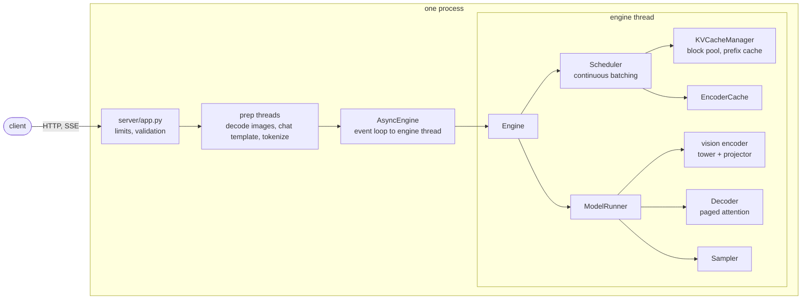

# vlmserve

[](https://github.com/eljandoubi/llm-inference/actions/workflows/ci.yml)

A small, readable server for vision-language models (VLMs). It does continuous
batching on a paged KV cache, caches prefixes in a way that knows which image a block
came from, and speaks the OpenAI chat API. It is plain PyTorch: the same code runs on
CPU, Apple silicon (MPS), CUDA and Intel XPU, with nothing to compile.

The engine design follows [PagedAttention](https://arxiv.org/abs/2309.06180) and vLLM,
and the compact walkthrough in [tinyserve](https://github.com/priyammaz/tinyserve).
Everything here is written for this repo and kept small on purpose: about 3,700 lines
of source, strict typing, 665 tests at 98% coverage.

- **Continuous batching with chunked prefill.** One token budget per step is shared by
  decodes and prefill chunks, so a long prompt never stalls the requests that are
  already generating.
- **Paged KV cache with prefix caching.** Blocks are hashed along the token chain; a
  block that overlaps an image also hashes the image content, so the same text with a
  different picture never reuses the wrong blocks.
- **Vision embedding cache.** A repeated image skips the vision tower, even when the
  text around it changed.
- **Real checkpoints.** Hugging Face LLaVA models (CLIP or SigLIP tower, Llama or Qwen2
  text model) and plain Llama / Qwen2 text models, from safetensors, old and new file
  layouts.
- **Any device.** Device and dtype are picked for you (bf16 on Ampere and newer, fp16
  on MPS and older GPUs, fp32 on CPU) by trying the ops the engine needs, not by
  trusting capability flags.
- **A server you can put in front of people.** Streaming and plain completions, usage
  with cached token counts, stop strings, request size limits, aborts when a client
  hangs up, a Prometheus `/metrics` page.

## Quick start

The project uses [uv](https://docs.astral.sh/uv/).

```sh
git clone https://github.com/eljandoubi/llm-inference && cd llm-inference
uv sync
uv run vlmserve devices        # what this machine can run on, and in which dtype
```

Serve a model, a Hub id or a local folder:

```sh
uv run vlmserve serve --model llava-hf/llava-interleave-qwen-0.5b-hf
```

Ask it about a picture:

```sh
IMG=$(base64 < cat.jpg | tr -d '\n')
curl -s localhost:8000/v1/chat/completions -H 'content-type: application/json' -d @- <<EOF
{"messages": [{"role": "user", "content": [
   {"type": "image_url", "image_url": {"url": "data:image/jpeg;base64,$IMG"}},
   {"type": "text", "text": "What is in this picture?"}]}],
 "max_tokens": 128}
EOF
```

Any OpenAI client works, for example:

```python
from openai import OpenAI

client = OpenAI(base_url="http://localhost:8000/v1", api_key="unused")
stream = client.chat.completions.create(
    model="llava-hf/llava-interleave-qwen-0.5b-hf",
    messages=[{"role": "user", "content": "Say hi in three languages."}],
    stream=True,
)
for part in stream:
    print(part.choices[0].delta.content or "", end="")
```

Or answer one prompt in the terminal, without a server:

```sh
uv run vlmserve generate --model <model> --image cat.jpg --prompt "What is in this picture?"
```

To try the whole stack without downloading anything, write a random model (the answers
are noise, the plumbing is the real thing):

```sh
uv run python -m benchmarks.random_model /tmp/tiny --preset tiny
uv run vlmserve generate --model /tmp/tiny --prompt "hello" --max-tokens 16
```

## What runs where

| Device | Status | Default dtype |
| --- | --- | --- |
| CPU | tested on every push (Linux and macOS in CI) | float32 |
| Apple silicon (MPS) | tested on an M4, and used for the benchmarks below | float16 |
| CUDA / ROCm | same code path, **not tested by the author** (no GPU was available) | bfloat16 on sm80+, else float16 |
| Intel XPU | same, not tested | bfloat16 |

`vlmserve devices` also warns about the classic mistake of a CPU-only torch next to an
NVIDIA card. On Linux the locked torch wheels are the default PyPI builds, which bring
the CUDA libraries along (a few GB); on a machine without a GPU you can swap in the CPU
wheel with `uv pip install torch --index-url https://download.pytorch.org/whl/cpu`.

| Model family | Example | State |
| --- | --- | --- |
| LLaVA, CLIP tower, Llama text | `llava-hf/llava-1.5-7b-hf` | config, tokenizer, processor, prompts and weight names checked against the real files (`pytest -m hub`) |
| LLaVA, SigLIP tower, Qwen2 text | `llava-hf/llava-interleave-qwen-0.5b-hf` | same, except the weight names (one weight file, no index to read) |
| Plain Llama / Qwen2 text | any | engine output equals transformers on random weights |

A word on what "checked" means. Downloading weights was not possible where this was
written (a proxy blocks the weight CDN), so the real models were never run end to end.
What was verified: the real configs, tokenizers, chat templates and image processors
produce exactly the prompts and pixel tensors transformers' own processor makes (576
placeholder tokens for llava-1.5, 729 for llava-interleave), and every tensor name of
llava-1.5's index lands in the decoder, the tower or the projector. The numerics are
tested the other way round: tiny randomly initialised llava models of both kinds are
written to disk, loaded by `vlmserve`, and the greedy tokens are compared with
`transformers`' `generate()` on CPU and MPS, with several requests in flight, chunked
prefill, and a repeated image coming out of the cache. If you run a real checkpoint,
please tell me how it went.

Not supported, and refused with a clear error: LLaVA-NeXT tiling, Idefics3/SmolVLM,
Qwen2-VL (needs M-RoPE), PaliGemma and Gemma 3 (bidirectional attention over images),
Llama 3.1-style RoPE scaling, sliding-window and MoE text models.

## How it works



**Scheduling.** Every step the scheduler fills one token budget (`--max-num-batched-tokens`):
running requests go first (a decode is one token, a request still in prefill takes a
chunk), then waiting ones, oldest first. Nobody jumps the queue. When the cache runs out of blocks, the *newest* request
gives its blocks back and starts over later, so an old request never loses its place to a
younger one. Image embedding has its own per-step budget, and a chunk is cut short
before an image that doesn't fit yet.

**KV cache.** Memory is a pool of fixed-size blocks (`--block-size`, 16 tokens). A
request holds a list of block ids and grows it as it goes, there is no reservation for
the longest possible answer. The cache is sized from the memory left after the weights
(`--kv-memory-fraction`), but never more than `--max-num-seqs` full-length sequences
could use.

**Prefix cache.** Each full block gets a digest of its tokens *and of its parent's
digest*, so a hit means the whole prefix matches. Placeholder tokens look the same for
every image, so a block that touches an image also hashes the image's content key and
the slice of it the block covers. Finished requests leave their blocks in the pool,
reusable until they are evicted; `usage.prompt_tokens_details.cached_tokens` tells the
client how much of its prompt was a hit.

**Vision path.** The frontend turns images into placeholder runs in the prompt and
pixel tensors. The runner embeds the images a step needs (batched through the tower),
splices the embeddings over the placeholder rows, and keeps them in an LRU cache
measured in tokens so the same image later skips the tower. A request drops its own
copy of an embedding as soon as the whole image has been computed.

**Serving.** One thread owns the engine; the event loop never waits for the model.
Tokenizing and image decoding run on a small thread pool, so a big JPEG doesn't stall
other requests either. Each request gets a queue the engine thread fills through
`call_soon_threadsafe`. If the client disconnects, the request is aborted and its
blocks are freed (also when the answer isn't streamed). If the engine thread dies, new
requests get a 503 and open streams get an error event.

**Why images are data URLs only.** A server that fetches whatever URL a client names is
a request-forgery hole, so remote image URLs are refused. Images are also limited in
count, bytes and pixels, the request body is capped while it streams in, and EXIF
rotation is applied. JPEGs are decoded at reduced size when the model will shrink them anyway.

## HTTP API

| Route | |
| --- | --- |
| `POST /v1/chat/completions` | text and `image_url` parts (base64 data URLs), `stream`, `stream_options.include_usage`, `max_tokens` / `max_completion_tokens`, `temperature`, `top_p`, `top_k`, `repetition_penalty`, `stop`, `ignore_eos` (a vLLM extension, handy for benchmarks) |
| `GET /v1/models` | the served name and its context window |
| `GET /health` | 200, or 503 once the engine thread is gone |
| `GET /metrics` | Prometheus text: running and waiting requests, KV usage, token counters, prefix and encoder cache hits |

Things that would change the answer and that the server cannot do (`tools`, `logprobs`,
`logit_bias`, `response_format` other than text, `frequency_penalty`, `n > 1`) are a
400, not silently ignored. Other errors are shaped like OpenAI's: 413 for an oversized
image or body, 499 when the client left, 503 when the engine is down.

## Command line

`vlmserve serve`, `vlmserve generate` and `vlmserve devices`; `--help` lists everything.
The ones you will touch:

| Flag | Default | |
| --- | --- | --- |
| `--model` | required | a local folder or a Hub repo id (`--revision` for a branch or commit) |
| `--device`, `--dtype` | `auto` | `cpu`, `cuda`, `cuda:1`, `mps`, `xpu`; `float32`, `float16`, `bfloat16` |
| `--max-model-len` | the model's, at most 4096 | context window |
| `--max-num-seqs` | 32 | requests running at once |
| `--max-num-batched-tokens` | 2048 | the per-step token budget |
| `--num-kv-blocks` / `--kv-memory-fraction` | free memory x 0.8 | KV cache size |
| `--no-prefix-caching` | off | turn the prefix cache off |
| `--host`, `--port` | `127.0.0.1`, 8000 | the server does not listen on the network unless asked |
| `--max-images`, `--max-image-bytes`, `--max-image-pixels` | 8, 10 MiB, 40 MP | per request limits |

The server has no authentication. Keep it on localhost, or put a reverse proxy that
checks credentials in front of it before exposing `--host 0.0.0.0`.

Out of memory? Lower `--max-model-len`, `--max-num-seqs` or `--kv-memory-fraction`.
Private or gated models: set `HF_TOKEN`; no network: `HF_HUB_OFFLINE=1` with a local
folder or a populated cache.

## Performance

These numbers are about the *serving stack*: batching, the prefix cache and the vision
cache. The model is a random llava-style checkpoint with real shapes (249M parameters: a
30-layer Llama and a ViT-B tower, 196 image tokens per image), made by
`benchmarks/random_model.py`, on an Apple M4 (16 GB) with MPS in float16. One run per
scenario, no other heavy work on the machine. Read them as ratios between
configurations, not as absolute speed, and not as a statement about any real model. The
raw outputs are in [`benchmarks/results`](benchmarks/results/apple-m4-mps.txt);
`benchmarks/suite.sh` reproduces them.

**Continuous batching.** 64 new tokens per request, prompts of about 575 tokens.

| Requests in flight | Output tokens/s | Time to first token (p50 / p90) | Gap between tokens (p50) |
| ---: | ---: | ---: | ---: |
| 1 | 37.6 | 142 / 149 ms | 24.7 ms |
| 4 | 63.6 | 670 / 1086 ms | 47.4 ms |
| 16 | 100.3 | 639 / 2428 ms | 123 ms |

Sixteen requests in flight give 2.7 times the throughput of one. The cost is latency per
token, as expected on a device that is already close to saturated.

**Prefix cache.** 32 requests, 4 in flight, prompts of about 940 tokens of which about 860
are the same system prompt, 32 new tokens.

| Prefix cache | Prompt tokens from cache | Time to first token (p50) | Output tokens/s | End to end (p50) |
| --- | ---: | ---: | ---: | ---: |
| on | 91% | 168 ms | 72.5 | 1.73 s |
| off | 0% | 1036 ms | 39.8 | 3.06 s |

**Images.** One image of 196 tokens plus a short question, 32 requests, 4 in flight.

| Setup | Prompt tokens from cache | Time to first token (p50) | Output tokens/s |
| --- | ---: | ---: | ---: |
| same image every time, both caches on | 71% | 134 ms | 111 |
| images drawn from a pool of 32, both caches on | 36% | 213 ms | 98 |
| same image, prefix cache off (embedding cache only) | 0% | 368 ms | 96 |

Run your own against any OpenAI-style server:

```sh
uv run vlmserve serve --model <model> &
uv run python -m benchmarks.load_test --requests 64 --rate 8 --images 1 --shared-words 100
```

It sends streamed requests on a Poisson schedule (or at a fixed concurrency) and reports
time to first token, the gap between tokens, throughput and cache hits.

## Development

```sh
uv sync                                   # locked dependencies, dev group included
uv run ruff check . && uv run ruff format --check .
uv run mypy                               # strict
uv run pytest --cov                       # no GPU, no downloads
uv run pytest -m hub                      # opt in: checks the real llava repos (network)
```

`uv add <package>` (`--dev` for tooling) keeps `uv.lock` current; commit it. CI runs
lint, mypy and the tests on Linux (Python 3.12 and 3.13) and macOS, and builds the
package.

The tests never touch the network. Numerics are checked against two references: a dense
(unpaged) implementation in `tests/dense.py`, and `transformers` itself on tiny random
checkpoints that `tests/tinyhf.py` writes to disk in the real file layouts (several
variants: classic and nested llava layouts, tied and untied embeddings, CLIP and SigLIP).
The model tests run on every device the machine has: CPU everywhere, plus MPS on a Mac.

```
src/vlmserve/
  engine.py, scheduler.py, runner.py   the core loop: schedule, run a batch, sample
  kv/                                  block pool, prefix hashing, KV cache manager
  model/                               decoder, paged attention, checkpoint reading
  multimodal/                          image decoding and limits, encoder cache
  hf/                                  llava vision tower, chat template frontend, loader
  server/                              FastAPI app, protocol, SSE, limits, metrics
  async_engine.py                      engine thread behind an asyncio interface
  device.py, config.py, cli.py         device and dtype choice, settings, commands
benchmarks/                            load test, random model writer, suite and results
tests/
```

To add a model family: write a `VisionEncoder` (embeds `pixel_values` into the text
model's space), a `Frontend` (chat template, tokenizer, image placeholders) and teach
`hf/loader.py` the new `model_type`. The engine only knows those two interfaces.

## Limits and what is next

- One process, one device. No tensor or pipeline parallelism, no speculative decoding,
  no quantization.
- The decoder covers Llama-style models with default RoPE. RoPE scaling, sliding
  windows and MoE are the first things to add for more text models.
- The attention kernel is PyTorch's SDPA over gathered blocks, not a fused paged kernel.
  It is correct everywhere and fast enough to show the scheduling wins above, but a
  fused CUDA/Triton kernel would be the next step for a big GPU.
- CUDA and XPU paths have not been run by the author.
- More VLM families (Idefics3/SmolVLM, Qwen2-VL) need their own frontends and, for
  Qwen2-VL, a different position encoding.

## Credits

[PagedAttention](https://arxiv.org/abs/2309.06180) (Kwon et al.) and the vLLM project for
the design, [tinyserve](https://github.com/priyammaz/tinyserve) for the idea of a small
readable version, Hugging Face `transformers` for the model definitions this is checked
against.

## License

Apache 2.0, see [LICENSE](LICENSE).
